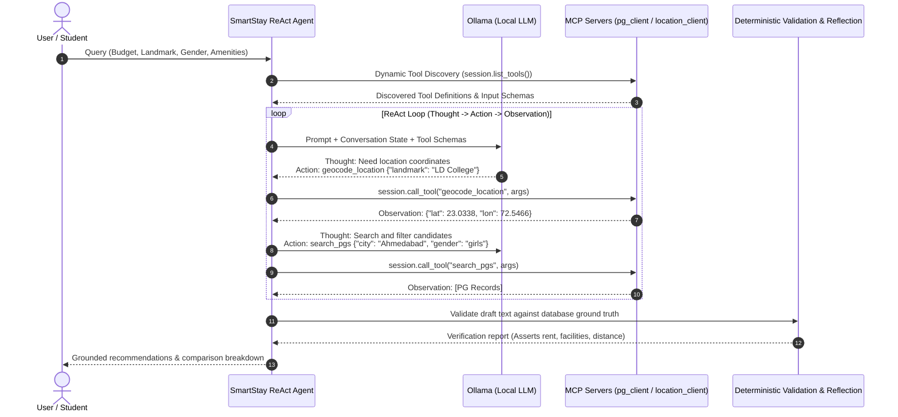

# 🏠 SmartStay: AI-Powered PG Finder Agent Using MCP

<div align="center">

[](https://www.python.org/)
[](https://modelcontextprotocol.io/)
[](https://github.com/jlowin/fastmcp)
[](https://www.npmjs.com/package/osm-mcp)
[-black?style=flat-square&logo=ollama&logoColor=white)](https://ollama.com/)
[](https://streamlit.io/)
[-10B981?style=flat-square&logo=pytest&logoColor=white)](https://docs.pytest.org/)

**Autonomous paying-guest accommodation discovery and ranking agent using Model Context Protocol (MCP), dynamic ReAct reasoning, and deterministic zero-hallucination verification.**

</div>

---

## 🌟 Overview & Key Capabilities

**SmartStay** is an autonomous accommodation discovery agent designed for students and young professionals seeking verified PG (paying-guest) accommodations in Ahmedabad. Built on top of the **Model Context Protocol (MCP)** standard, SmartStay combines dynamic LLM reasoning with deterministic spatial and factual guardrails:

- **Genuine Multi-Server MCP Architecture**: The main agent communicates with a custom FastMCP accommodation server (`smartstay-pg-server`) and a pre-built OpenStreetMap server (`osm-mcp`) via official MCP `ClientSession` over `stdio`.
- **Dynamic Tool Discovery**: Discovers tools and input schemas dynamically at runtime via `session.list_tools()`, eliminating static catalogs.
- **Dynamic ReAct Loop**: Executes autonomous iterative reasoning (`Thought` $\rightarrow$ `Action` $\rightarrow$ `Observation`) over MCP tool transports.
- **Strict Factual Claim Verification**: Sentence-level parsing verifies claimed rent, facilities, and listing IDs against ground truth records in pure Python.
- **Grounded Response Generation**: Final recommendation prose is constructed strictly from verified listings; rejected or over-budget accommodations are purged.
- **Explainable Scoring (0–100 pts)**: Mathematical ranking across budget savings, spatial proximity, amenity matches, and user ratings.
- **Dual Interfaces**: Interactive CLI terminal with automated transcript recording (`agent.py --record`) and a full-featured Streamlit dashboard (`app.py`).

---

## 🛡️ Resolution of Level 2 Reviewer Blockers

This codebase includes complete remediations for all five Level 2 practitioner approval blockers:

| # | Blocker | Problem Description | Production Remediation | Verification Status |
| :---: | :--- | :--- | :--- | :---: |
| **1** | **MCP Integration** | Agent called local Python functions directly, bypassing MCP server | Added `mcp_servers/pg_client.py` using official MCP SDK `ClientSession` over `stdio`; agent executes all PG operations via `pg_client.call_tool()` | ✅ **Verified** (`test_mcp_tools.py`) |
| **2** | **Factual Verification** | False claims (e.g. ₹1 rent, invented pool) passed validation | Added sentence-level claim extraction in `services/validation_service.py`; reflection auditor hard-gated from overriding deterministic errors | ✅ **Verified** (`test_validation.py`) |
| **3** | **Grounded Final Prose** | Excluded listings remained in final text; `success=True` on errors | Rebuilt `_build_grounded_response()` to emit only verified listings; text leakage check rejects excluded IDs; `success` tracks validation | ✅ **Verified** (`test_agent.py`) |
| **4** | **Natural Language Parser** | "8k" parsed as ₹8; "within 3 km" set budget to 3; "ac" matched "accommodation" | Multiplier regex for `k`/`thousand`; separated distance units (`km`); word boundary `\bac\b`; removed automatic LD College fallback | ✅ **Verified** (`test_agent.py`) |
| **5** | **Missing GPS Coordinates** | Missing GPS coordinates passed strict distance checks | Listings with missing GPS (`pg_ahm_012`) are excluded from ranking when distance limits are specified; flagged unverified otherwise | ✅ **Verified** (`test_scoring.py`) |

---

## 🏗️ System Architecture

```mermaid
graph TD
    User([User Request]) --> UI[Streamlit Web App / CLI]
    UI --> Agent[SmartStay ReAct Agent]
    
    subgraph Cognitive Layer
        Agent <--> LLM[Local LLM via Ollama<br/>Mistral 7B / Llama 3.2]
    end

    subgraph MCP Multi-Server Protocol (stdio)
        Agent <== "stdio: ClientSession" ==> MCP_PG[Custom PG Server: FastMCP<br/>• search_pgs • filter_by_budget<br/>• check_amenities • rank_pgs<br/>• calculate_distance • compare_pgs]
        Agent <== "stdio: ClientSession" ==> MCP_OSM[Pre-Built OSM Server: osm-mcp<br/>• geocode • straight_line_distance]
    end

    subgraph Dual-Layer Verification Guardrail
        Agent --> Val[Deterministic Rule Validator<br/>• Rent check • Amenity check • ID check]
        Val --> Ref[One-Shot Reflection Auditor<br/>• Hard priority gate • Evidence audit]
        Ref --> Response([Verified Grounded Recommendation])
    end
```

---

## ⚡ ReAct Execution & Tool-Calling Flow



---

## 📊 Explainable Scoring Formula (100 Points)

SmartStay ranks matching accommodations using a transparent, multi-factor scoring formula defined in [`services/scoring_service.py`](file:///c:/Users/KavyaPatel/Downloads/L2%20FINAL%20PROJECT/services/scoring_service.py):

$$\text{Total Score} = \text{Budget Score (30)} + \text{Proximity Score (30)} + \text{Amenity Score (25)} + \text{Rating Score (15)}$$

| Factor | Max Weight | Exact Formula in Code | Implementation Rationale |
| :--- | :---: | :--- | :--- |
| **Budget Proximity** | **30 pts** | If $\text{Rent} \le \text{Budget}$:<br/>$20.0 + \min\left(\frac{\text{Budget} - \text{Rent}}{\text{Budget}} \times 10, 10.0\right)$<br/>If $\text{Rent} > \text{Budget}$: $0.0\text{ pts}$ | Awards a 20-point baseline for staying under budget, plus up to 10 bonus points for savings. Disqualifies over-budget listings. |
| **Distance Proximity** | **30 pts** | $\le 1.0\text{ km} \rightarrow \mathbf{30.0\text{ pts}}$<br/>$1.0 - 2.0\text{ km} \rightarrow \mathbf{25.0\text{ pts}}$<br/>$2.0 - 3.0\text{ km} \rightarrow \mathbf{20.0\text{ pts}}$<br/>$3.0 - 5.0\text{ km} \rightarrow \mathbf{12.0\text{ pts}}$<br/>$> 5.0\text{ km} \rightarrow \max\left(10 - (\text{dist}-5)\times 2, 0\right)$ | Prioritizes walkable accommodations close to college or workplace. Missing coordinates receive 0 pts and are excluded if distance is strict. |
| **Amenity Match** | **25 pts** | $25.0 \times \frac{\text{Matched Amenities}}{\text{Requested Amenities}}$ | Proportional reward for each requested facility (Wi-Fi, Food, AC, Laundry, etc.). Full score if no specific amenities are requested. |
| **User Rating** | **15 pts** | $15.0 \times \frac{\text{Verified Rating}}{5.0}$ | Grounded in verified resident reviews. Defaults to neutral 10 pts (3.33 rating) if unrated. |

### Worked Example: Shiv Shakti Boys PG (`pg_ahm_003`)
* **User Query**: Boys PG near LD College, max budget ₹9,000, requesting AC.
* **Database Values**: Rent = ₹8,000/mo, Haversine distance = 0.33 km, Amenities include AC, Rating = 4.6/5.0.
* **Score Calculation**:
  1. $\text{Budget Score} = 20.0 + \min\left(\frac{9000 - 8000}{9000} \times 10, 10\right) = 20.0 + 1.11 = \mathbf{21.11\text{ pts}}$
  2. $\text{Distance Score} = 0.33\text{ km} \le 1.0\text{ km} \rightarrow \mathbf{30.00\text{ pts}}$
  3. $\text{Amenity Score} = 25.0 \times \frac{1}{1} = \mathbf{25.00\text{ pts}}$
  4. $\text{Rating Score} = 15.0 \times \frac{4.6}{5.0} = \mathbf{13.80\text{ pts}}$
* **Total Score**: $21.11 + 30.00 + 25.00 + 13.80 = \mathbf{89.91\text{ / }100}$ (Rank #1)

---

## 🗄️ Dataset Provenance & Edge-Case Modeling

The database [`data/pg_records.json`](file:///c:/Users/KavyaPatel/Downloads/L2%20FINAL%20PROJECT/data/pg_records.json) contains **12 realistic accommodations** across major student hubs in Ahmedabad (Navrangpura, Gulbai Tekra, Vastrapur, Memnagar, Naranpura):
- **Verified Coordinates**: 11 records have real geographic coordinates grounded against OpenStreetMap landmarks.
- **Missing Coordinates Edge Case (`pg_ahm_012`)**: "Radhe Krishna Co-Living" intentionally features `latitude: null` and `longitude: null`. This models real-world API geocoding failures:
  - If a user specifies a **strict distance limit** ("within 2 km"), `pg_ahm_012` is excluded because proximity cannot be proven.
  - If no distance limit is requested, `pg_ahm_012` is included with distance score `0.0` and clearly marked `"Distance unverified"`.
- **Distance Disclaimer**: SmartStay calculates spherical distances using the **Haversine formula** and explicitly labels all outputs as straight-line distance rather than walking or driving routes.

---

## 📁 Repository Structure

```
SmartStay-AI-PG-Finder/
├── agent.py                    # CLI entrypoint with transcript recording (--record)
├── app.py                      # Interactive Streamlit Web Application
├── config.py                   # Central settings, paths, timeouts, and scoring weights
├── requirements.txt            # Python dependencies (mcp, fastmcp, pydantic, httpx, etc.)
├── pytest.ini                  # Pytest configuration with asyncio and markers
│
├── agents/
│   ├── smartstay_agent.py      # Core ReAct agent with MCP ClientSession integration
│   └── reflection_agent.py     # Deterministic-gated reflection auditor & fallback
│
├── mcp_servers/
│   ├── __init__.py             # Exports PGClient and LocationClient
│   ├── pg_server.py            # Custom FastMCP server exposing 7 accommodation tools
│   ├── pg_client.py            # Official MCP stdio client connecting to pg_server.py
│   ├── location_client.py      # Official MCP stdio client connecting to osm-mcp
│   └── server_config.json      # Dual-server MCP configuration
│
├── tools/
│   ├── pg_search.py            # Search listings by city and gender
│   ├── budget_filter.py        # Strict budget threshold filtering
│   ├── amenity_checker.py      # Facility matching and mandatory checks
│   ├── distance_calculator.py  # Haversine distance calculations
│   └── pg_ranker.py            # Multi-factor explainable ranking engine
│
├── database/                   # Data service and verified landmark catalog
├── data/                       # Verified PG records dataset (pg_records.json)
├── services/
│   ├── scoring_service.py      # 0–100 mathematical scoring engine
│   └── validation_service.py   # Sentence-level factual claim verification
│
├── models/                     # Pydantic schemas (Listings, Validation, Reflection)
├── prompts/                    # ReAct agent system prompt and reflection auditor prompt
├── tests/                      # Automated unit, regression, and MCP tests (41 passed)
├── docs/                       # Architecture, testing, and viva preparation guides
└── evidence/                   # Recorded CLI demonstration transcripts
```

---

## 🚀 Quickstart Guide

### 1. Prerequisites
- **Python 3.10, 3.11, or 3.12**
- **Node.js 18+ & npx** *(for the external `osm-mcp` geospatial server)*
- **Ollama**: Download from [ollama.com](https://ollama.com) and pull a model:
  ```powershell
  ollama pull mistral:7b
  # or lightweight alternative:
  ollama pull llama3.2:3b
  ```

### 2. Setup & Installation
```powershell
# Clone the repository
git clone https://github.com/PS-kavya-patel/SmartStay-AI-PG-Finder.git
cd SmartStay-AI-PG-Finder

# Create and activate virtual environment
python -m venv .venv
.\.venv\Scripts\Activate.ps1

# Install dependencies
pip install -r requirements.txt
```

### 3. Run Automated Tests
Execute the comprehensive test suite verifying all 5 approval blockers and core features:
```powershell
.\.venv\Scripts\pytest -v -m "not integration"
```
✅ **41 passed, 1 deselected in ~45 seconds** (100% passing across all 5 test modules).

### 4. Run CLI Demonstration
Run the autonomous ReAct agent with automatic live transcript logging:
```powershell
python agent.py --record --query "Find a girls' PG in Ahmedabad under ₹8,000 per month, within 3 km of LD College, with Wi-Fi and food."
```
The full execution trace is automatically captured in [`evidence/demo_transcript.txt`](file:///c:/Users/KavyaPatel/Downloads/L2%20FINAL%20PROJECT/evidence/demo_transcript.txt).

### 5. Launch Streamlit Web App
```powershell
streamlit run app.py
```
Open **`http://localhost:8501`** in your browser to access the interactive search dashboard, ReAct trace visualizer, and PG comparison table.

---

## 🧪 Comprehensive Test Suite Breakdown

The test suite covers edge cases, boundary conditions, MCP transports, and regression scenarios:

| Test File | Tests Passed | Key Capabilities Verified |
|---|:---:|---|
| [`tests/test_agent.py`](file:///c:/Users/KavyaPatel/Downloads/L2%20FINAL%20PROJECT/tests/test_agent.py) | **8** | Dynamic MCP tool discovery; ReAct iteration limit (max 6); criteria extraction blockers ("8k", "3 km", "\bac\b", no landmark fallback); final prose regeneration without rejected PGs. |
| [`tests/test_mcp_tools.py`](file:///c:/Users/KavyaPatel/Downloads/L2%20FINAL%20PROJECT/tests/test_mcp_tools.py) | **14** | FastMCP stdio client discovery; `call_tool()` execution over MCP; strict distance exclusion of missing GPS (`pg_ahm_012`); budget boundary checks; amenity checks; Haversine range validation. |
| [`tests/test_scoring.py`](file:///c:/Users/KavyaPatel/Downloads/L2%20FINAL%20PROJECT/tests/test_scoring.py) | **3** | Exact mathematical scoring (budget, distance, amenities, rating); unverified distance score calculation; distance cutoff filtering. |
| [`tests/test_search.py`](file:///c:/Users/KavyaPatel/Downloads/L2%20FINAL%20PROJECT/tests/test_search.py) | **7** | Candidate searches by gender, city, and neighborhood; detail lookups; empty search handling. |
| [`tests/test_validation.py`](file:///c:/Users/KavyaPatel/Downloads/L2%20FINAL%20PROJECT/tests/test_validation.py) | **9** | Factual claim rejection (₹1 rent, swimming pool); rejected PG prose leakage guard; strict distance rejection of missing GPS; budget and gender violations; reflection correction. |
| **Total** | **41** | **All 41 non-integration tests passing with 0 failures.** |

---

## 🛠️ Troubleshooting & Production Notes

### Ollama Offline or Slow Response
* **Graceful Degradation**: If Ollama is offline or takes longer than `LLM_TIMEOUT` (15s), SmartStay transitions to its verified deterministic execution pipeline (`_deterministic_execution`).
* Tool calls, geocoding, distance calculations, and scoring run deterministically over MCP with zero downtime.

### Windows Subprocess & Stdio Buffering
* FastMCP communicates over standard input/output. Python subprocesses on Windows require unbuffered I/O.
* `mcp_servers/pg_client.py` sets `PYTHONUNBUFFERED=1` and `-u` flag on process invocation to guarantee zero deadlock in stdio communication.

### OpenStreetMap MCP (`osm-mcp`)
* The location client invokes `npx -y osm-mcp` with bounded thread timeouts.
* If external network connectivity is restricted, SmartStay automatically falls back to its verified landmark catalog (`database/verified_landmarks.json`), preventing crashes while preserving spatial accuracy.

---

## 📚 Documentation & Viva Defense Resources

- 📐 **[System Architecture Guide](docs/architecture.md)**: Multi-server MCP design, data flow, and schemas.
- 🧪 **[Testing & Quality Strategy](docs/testing.md)**: Detailed test matrix, edge cases, and regression coverage.
- 🎓 **[Viva Preparation Guide](docs/viva_questions.md)**: Answers to core concepts and all 8 reviewer defence questions.

---

## 📄 License

Distributed under the **MIT License**. Created by **Kavya Patel**.
