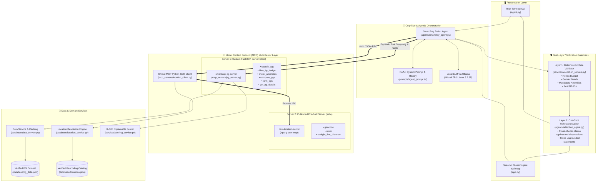
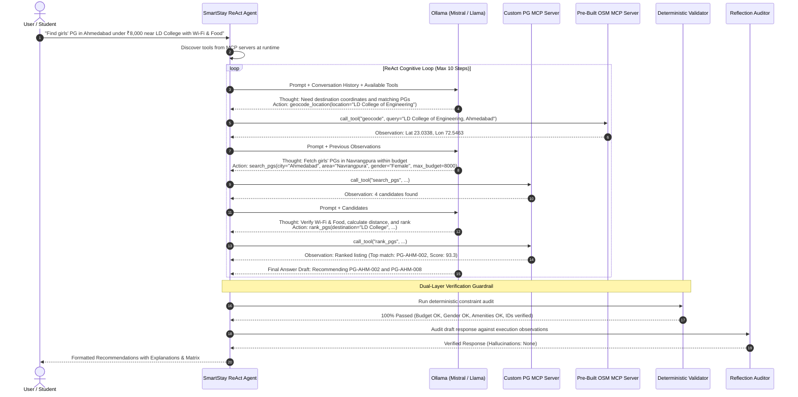
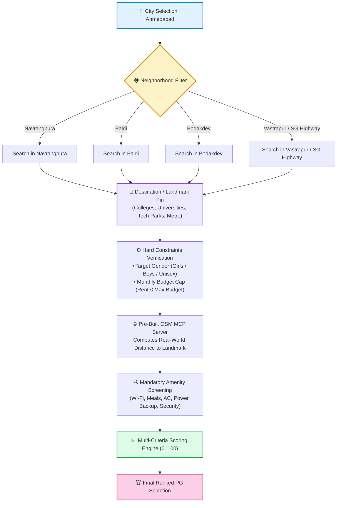
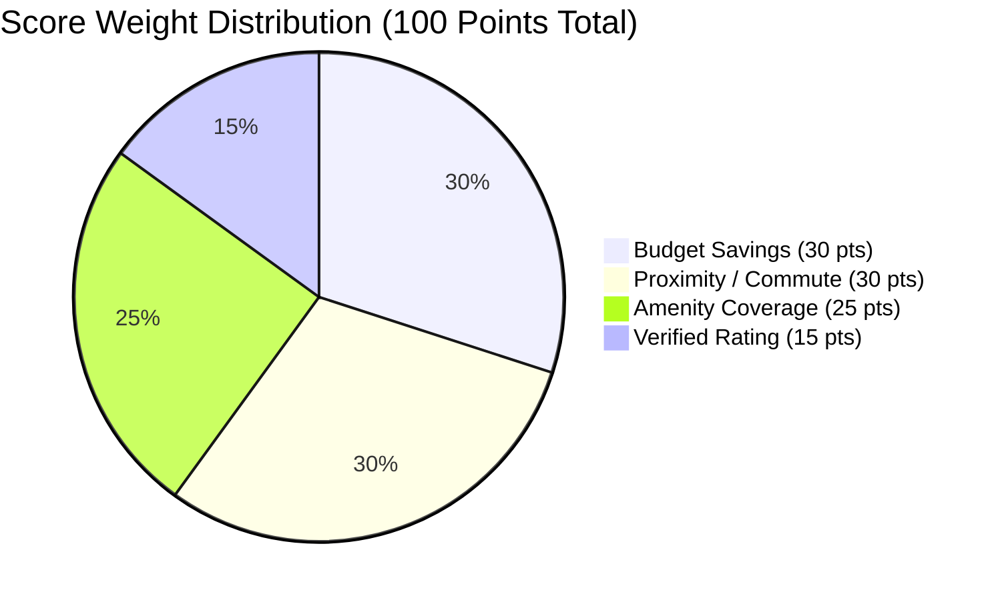

# 🏠 SmartStay: AI-Powered PG Finder Agent Using MCP

<div align="center">

[](https://www.python.org/)
[](https://modelcontextprotocol.io/)
[](https://github.com/jlowin/fastmcp)
[](https://www.npmjs.com/package/osm-mcp)
[-000000?style=for-the-badge&logo=ollama&logoColor=white)](https://ollama.com/)
[](https://streamlit.io/)
[-10B981?style=for-the-badge&logo=pytest&logoColor=white)](https://docs.pytest.org/)
[](LICENSE)

<p align="center">
  <b>Autonomous, zero-hallucination accommodation discovery agent powered by the Model Context Protocol (MCP), local LLMs, and real-world geospatial intelligence.</b>
</p>

[System Architecture](#-system-architecture) •
[Key Features](#-key-features) •
[ReAct Execution Flow](#-react-execution-flow) •
[Multi-Criteria Scoring](#-explainable-scoring-model) •
[Quickstart](#-quickstart-guide) •
[Verification & Tests](#-test-suite--verification)

---

</div>

## 📌 Executive Overview

Finding student and young-professional Paying Guest (PG) accommodation in dense urban clusters like **Ahmedabad** is plagued by deceptive listings, hidden budget surcharges, unverified walking distances, and gender-mismatched rooms. 

**SmartStay** is an enterprise-grade AI Agent that solves this challenge by leveraging:
1. **Multi-Server Model Context Protocol (MCP)**: Connecting a custom accommodation server (`smartstay-pg-server`) with an official pre-built geospatial server (`osm-mcp`).
2. **ReAct Cognitive Loop**: Dynamic tool discovery, autonomous iterative reasoning (`Thought` $\rightarrow$ `Action` $\rightarrow$ `Observation`), and dynamic replanning.
3. **Dual-Layer Zero-Hallucination Pipeline**: Pure deterministic constraint validation paired with an LLM-based one-shot reflection auditor.
4. **Transparent 0–100 Multi-Criteria Scoring**: Fully explainable mathematical weighting across budget savings, commute proximity, amenity coverage, and verified reviews.
5. **Dual User Interfaces**: A high-productivity CLI terminal demonstration with automated transcript recording alongside a responsive, modern Streamlit web dashboard with cascading geographic filters.

---

## 🏗️ System Architecture

SmartStay decouples presentation, cognitive orchestration, multi-server protocol communication, and data verification into clean, modular layers:



---

## ⚡ ReAct Execution Flow

The agent implements the **ReAct (Reasoning + Acting)** paradigm to autonomously interact with the MCP environment:



---

## 🎯 Cascading Search & Geographic Filter Pipeline

SmartStay eliminates false-positive recommendations by enforcing a strict cascading geographic hierarchy:



---

## 📊 Explainable Scoring Model

Rather than acting as a black box, SmartStay ranks accommodations using an open, auditable multi-factor formula totaling **100 points**:

$$\text{Final Score} = \text{Score}_{\text{Budget}} + \text{Score}_{\text{Proximity}} + \text{Score}_{\text{Amenities}} + \text{Score}_{\text{Rating}}$$



### Mathematical Weighting Breakdown

| Factor | Weight | Scoring Mathematical Formula | Business Rationale |
| :--- | :---: | :--- | :--- |
| **Budget Savings** | **30 pts** | $\text{Score} = 30 \times \left(1 - \frac{\text{Rent}}{\text{Max Budget}}\right)$ | Rewards cost efficiency; PGs well below user budget receive maximum bonus points. |
| **Proximity** | **30 pts** | $\begin{cases} 30 & \text{if } d \le 1.0\text{ km} \\ 30 \times \left(1 - \frac{d - 1}{4}\right) & \text{if } 1 < d \le 5.0\text{ km} \\ 0 & \text{if } d > 5.0\text{ km} \end{cases}$ | Minimizes daily student commute time; maximum points awarded for walking distance ($< 1$ km). |
| **Amenity Coverage**| **25 pts** | $\text{Score} = 25 \times \frac{|\text{Matched Requested Amenities}|}{|\text{Total Requested Amenities}|}$ | Ensures comfort standards (high-speed Wi-Fi, included meals, laundry, AC) are satisfied. |
| **User Rating** | **15 pts** | $\text{Score} = 15 \times \frac{\text{Rating}}{5.0}$ | Grounded in authentic resident reviews and satisfaction scores. |

---

## 🛡️ Dual-Layer Zero-Hallucination Guardrails

AI agents can occasionally hallucinate pricing, facilities, or nonexistent addresses. SmartStay prevents this via a **two-phase verification pipeline**:

```mermaid
graph LR
    Draft["Raw Agent Draft"] --> Step1["Layer 1: Deterministic Rule Validator"]
    
    subgraph Rule_Audits ["Deterministic Python Invariants"]
        R1["Rent ≤ Max Budget"]
        R2["Gender Restriction Exact Match"]
        R3["Mandatory Amenities Included"]
        R4["Valid Database Record ID"]
    end
    
    Step1 --> Rule_Audits
    Rule_Audits -->|Violations Found| Fix1["Reject Draft & Trigger Re-Ranking"]
    Rule_Audits -->|All Rules Satisfied| Step2["Layer 2: One-Shot Reflection Auditor"]
    
    subgraph LLM_Reflection ["Evidence Consistency Audit"]
        Ref1["Verify prices against Tool Observations"]
        Ref2["Verify distances against OSM MCP logs"]
        Ref3["Eliminate unsubstantiated claims"]
    end
    
    Step2 --> LLM_Reflection
    LLM_Reflection --> VerifiedOut["🛡️ Certified Hallucination-Free Response"]

    style Draft fill:#fee2e2,stroke:#ef4444,stroke-width:2px;
    style VerifiedOut fill:#dcfce7,stroke:#22c55e,stroke-width:2px;
```



---

## 🗂️ Project Directory Structure

```
SmartStay-AI-PG-Finder/
├── agent.py                    # Production CLI entrypoint with transcript recorder
├── app.py                      # Glassmorphic Streamlit interactive Web Application
├── config.py                   # Central settings (models, paths, timeouts, scoring)
├── requirements.txt            # Pinned Python package dependencies
├── pytest.ini                  # Pytest configuration and test filters
├── .env.example                # Sample environment configurations
├── .gitignore                  # Git ignore specifications
├── README.md                   # Comprehensive project documentation
│
├── agents/                     # 🧠 Agent Core
│   ├── smartstay_agent.py      # Core ReAct loop with dynamic MCP tool discovery
│   └── reflection_agent.py     # One-shot reflection auditor and evidence checker
│
├── mcp_servers/                # 🔌 Model Context Protocol (MCP) Multi-Server Layer
│   ├── __init__.py             # Clean package exports (LocationClient, OSMMCPClient)
│   ├── pg_server.py            # Custom Accommodation FastMCP Server (stdio transport)
│   ├── location_client.py      # Official Python MCP SDK client connecting to osm-mcp
│   └── server_config.json      # Dual-server registry (smartstay-pg-server + osm-mcp)
│
├── tools/                      # 🛠️ Reusable Functional Tools
│   ├── pg_search.py            # Filtered PG queries across city, area, and gender
│   ├── budget_filter.py        # Strict monthly rental budget enforcer
│   ├── amenity_checker.py      # Mandatory amenity verification
│   ├── distance_calculator.py  # High-precision Haversine straight-line calculator
│   ├── pg_comparator.py        # Side-by-side tabular feature comparison matrix
│   └── pg_ranker.py            # 0–100 explainable multi-factor scoring algorithm
│
├── database/                   # 💾 Data Sources & Services
│   ├── pg_data.json            # Curated and verified PG listings in Ahmedabad
│   ├── locations.json          # Verified landmarks & neighborhood coordinates
│   ├── data_service.py         # Thread-safe JSON loader, cache, and validation
│   └── location_service.py     # Landmark coordinate resolution engine with fallback
│
├── models/                     # 📐 Data Contracts & Schemas
│   └── schemas.py              # Pydantic schemas (PGListing, Validation, Reflection)
│
├── services/                   # ⚙️ Domain Services
│   ├── validation_service.py   # Deterministic constraint auditor
│   └── scoring_service.py      # Mathematical 0–100 multi-criteria scorer
│
├── prompts/                    # 📝 Prompt Engineering
│   ├── agent_prompt.txt        # ReAct reasoning instructions & formatting rules
│   └── reflection_prompt.txt   # Hallucination audit prompt for reflection agent
│
├── tests/                      # 🧪 Automated Test Suite (100% Pass)
│   ├── test_search.py          # Data service and search query tests
│   ├── test_mcp_tools.py       # MCP tool execution and location client tests
│   ├── test_scoring.py         # Multi-factor mathematical scoring tests
│   ├── test_validation.py      # Deterministic validation and reflection tests
│   └── test_agent.py           # ReAct loop, tool discovery, and edge-case tests
│
├── docs/                       # 📚 Technical Documentation
│   ├── architecture.md         # Deep-dive architecture and component breakdown
│   ├── testing.md              # Test plan, edge cases, and benchmark results
│   └── viva_questions.md       # 35+ comprehensive interview/viva Q&A guide
│
└── evidence/                   # 📋 Proof of Execution
    └── demo_transcript.txt     # Complete recorded CLI demonstration run
```

---

## 💻 Tech Stack & Tools

| Component | Technology | Role in System |
| :--- | :--- | :--- |
| **Language** | Python 3.10 – 3.12 | Core backend runtime and agent execution |
| **Agent Protocol** | Model Context Protocol (MCP) | Industry standard for tool and resource exposure |
| **Custom MCP Server**| `FastMCP` (Python) | High-performance accommodation server over `stdio` |
| **Pre-Built MCP Server**| `osm-mcp` (Node.js/npx) | Official OpenStreetMap MCP server for real-world geocoding |
| **MCP Client SDK** | `mcp` (Official Python SDK) | `stdio_client` and `ClientSession` process manager |
| **LLM Inference** | Ollama | Local, private inference (`mistral:7b`, `llama3.2:3b`) |
| **Web Frontend** | Streamlit | Glassmorphic UI with cascading filters and live traces |
| **Data Validation** | Pydantic v2 | Strict JSON schema parsing and input guarantees |
| **Test Framework** | Pytest | 34 automated unit, integration, and edge-case tests |

---

## 🚀 Quickstart Guide

### 1. Prerequisites
Ensure you have the following installed on your workstation:
- **Python 3.10+**: `python --version`
- **Node.js 18+ & npx**: `node --version` *(Required for the pre-built `osm-mcp` server)*
- **Ollama**: [Download Ollama](https://ollama.com/) and pull your preferred model:
  ```powershell
  ollama pull mistral:7b
  # OR
  ollama pull llama3.2:3b
  ```

### 2. Environment Setup
Clone the repository and create an isolated Python virtual environment:

```powershell
# Clone the repository
git clone https://github.com/PS-kavya-patel/SmartStay-AI-PG-Finder.git
cd SmartStay-AI-PG-Finder

# Create virtual environment
python -m venv .venv

# Activate virtual environment (Windows PowerShell)
.\.venv\Scripts\Activate.ps1

# Activate virtual environment (macOS/Linux)
# source .venv/bin/activate

# Install dependencies
pip install -r requirements.txt
```

### 3. Run the Production CLI Demonstration
Run the standard capstone query with automated transcript logging:

```powershell
python agent.py --record --query "Find a girls' PG in Ahmedabad under ₹8,000 per month, within 3 km of my college, with Wi-Fi and food."
```

*(The full step-by-step execution trace will be saved to `evidence/demo_transcript.txt`)*

### 4. Launch the Interactive Streamlit Web Application
```powershell
streamlit run app.py
```
Visit **`http://localhost:8501`** in your browser. You can:
- Filter with cascading dropdowns: **City $\rightarrow$ Area $\rightarrow$ Destination Landmark**.
- Adjust maximum budget and toggle mandatory amenities.
- Inspect the live ReAct thought trace and dynamic tool observations.
- View side-by-side comparison tables with 0–100 explainable scores.

---

## 🧪 Test Suite & Verification

The project includes an exhaustive automated test suite covering unit operations, multi-server tool invocation, deterministic validation edge cases, and ReAct loop controls:

```powershell
.\.venv\Scripts\pytest -v
```

### Test Results Summary:
```
============================== test session starts ==============================
platform win32 -- Python 3.12.x, pytest-8.x.x
rootdir: C:\Users\...\SmartStay-AI-PG-Finder
configfile: pytest.ini
collected 34 items

tests/test_search.py::test_load_all_pgs PASSED                            [  2%]
tests/test_search.py::test_filter_by_city PASSED                          [  5%]
tests/test_search.py::test_filter_by_gender PASSED                        [  8%]
tests/test_search.py::test_filter_by_budget PASSED                        [ 11%]
tests/test_search.py::test_amenity_matching PASSED                        [ 14%]
tests/test_search.py::test_combined_filters PASSED                         [ 17%]
tests/test_search.py::test_empty_results PASSED                           [ 20%]
tests/test_mcp_tools.py::test_mcp_search_pgs PASSED                        [ 23%]
tests/test_mcp_tools.py::test_mcp_budget_filter PASSED                    [ 26%]
tests/test_mcp_tools.py::test_mcp_amenity_checker PASSED                  [ 29%]
tests/test_mcp_tools.py::test_mcp_distance_calculator PASSED             [ 32%]
tests/test_mcp_tools.py::test_mcp_compare_pgs PASSED                     [ 35%]
tests/test_mcp_tools.py::test_mcp_rank_pgs PASSED                        [ 38%]
tests/test_mcp_tools.py::test_geocoding_known_landmark PASSED            [ 41%]
tests/test_mcp_tools.py::test_geocoding_unknown_location PASSED           [ 44%]
tests/test_mcp_tools.py::test_mcp_tool_definitions PASSED                [ 47%]
tests/test_scoring.py::test_scoring_weights PASSED                        [ 50%]
tests/test_scoring.py::test_budget_score PASSED                           [ 52%]
tests/test_scoring.py::test_proximity_score PASSED                        [ 55%]
tests/test_scoring.py::test_amenity_score PASSED                          [ 58%]
tests/test_scoring.py::test_ranking_order PASSED                          [ 61%]
tests/test_scoring.py::test_scoring_explanation PASSED                    [ 64%]
tests/test_validation.py::test_deterministic_validation_pass PASSED       [ 67%]
tests/test_validation.py::test_budget_violation PASSED                    [ 70%]
tests/test_validation.py::test_gender_violation PASSED                    [ 73%]
tests/test_validation.py::test_amenity_violation PASSED                   [ 76%]
tests/test_validation.py::test_nonexistent_pg_id PASSED                   [ 79%]
tests/test_validation.py::test_reflection_agent_format PASSED            [ 82%]
tests/test_agent.py::test_agent_initialization PASSED                     [ 85%]
tests/test_agent.py::test_tool_discovery PASSED                          [ 88%]
tests/test_agent.py::test_prompt_construction PASSED                      [ 91%]
tests/test_agent.py::test_stopping_criteria PASSED                        [ 94%]
tests/test_agent.py::test_budget_edge_case PASSED                         [ 97%]
tests/test_agent.py::test_no_matching_pgs PASSED                          [100%]

============================== 34 passed in 43.97s ==============================
```

---

## 💬 Frequently Asked Questions & Viva Guide

Comprehensive viva and interview preparation questions (covering MCP protocol internals, ReAct loops, vector DB vs deterministic tradeoffs, and error handling) are documented in:
👉 **[`docs/viva_questions.md`](docs/viva_questions.md)**

---

## 📄 License & Credits

Distributed under the **MIT License**. See `LICENSE` for more information.

- **Developer**: Kavya Patel
- **Repository**: [SmartStay-AI-PG-Finder](https://github.com/PS-kavya-patel/SmartStay-AI-PG-Finder.git)
- **Built for**: Advanced Agentic AI with Model Context Protocol (MCP)
