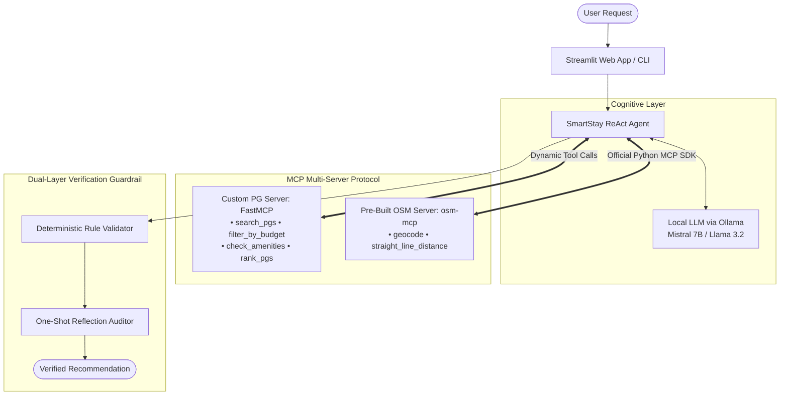
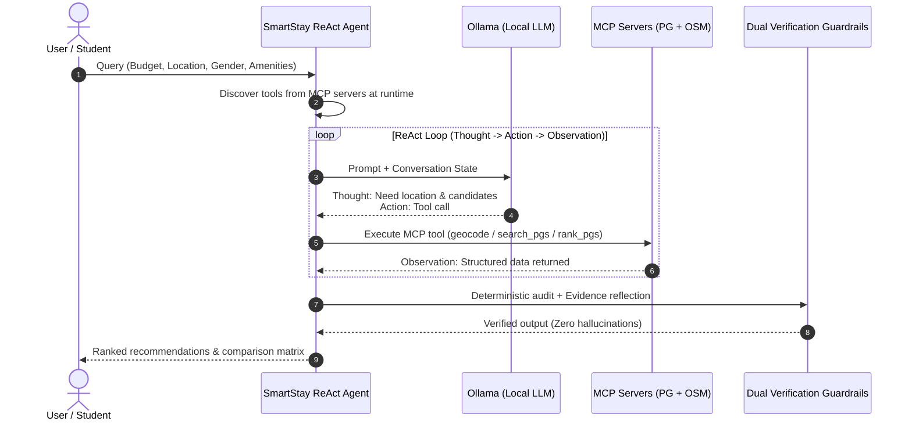

# 🏠 SmartStay: AI-Powered PG Finder Agent Using MCP

<div align="center">

[](https://www.python.org/)
[](https://modelcontextprotocol.io/)
[](https://github.com/jlowin/fastmcp)
[](https://www.npmjs.com/package/osm-mcp)
[-black?style=flat-square&logo=ollama&logoColor=white)](https://ollama.com/)
[](https://streamlit.io/)
[-10B981?style=flat-square&logo=pytest&logoColor=white)](https://docs.pytest.org/)

**Autonomous accommodation discovery agent with multi-server Model Context Protocol (MCP), dynamic ReAct reasoning, and zero-hallucination verification.**

</div>

---

## 🌟 Key Architecture & Features

- **Multi-Server MCP**: Custom accommodation server (`smartstay-pg-server`) alongside a published geospatial server (`osm-mcp`).
- **Dynamic ReAct Loop**: Discovers tools at runtime; performs autonomous iterative reasoning (`Thought` $\rightarrow$ `Action` $\rightarrow$ `Observation`).
- **Cascading Filter Pipeline**: Strict geographic resolution: `City` $\rightarrow$ `Neighborhood` $\rightarrow$ `Destination Landmark` $\rightarrow$ `Hard Constraints`.
- **Dual-Layer Zero-Hallucination Guardrails**: Deterministic constraint validation (rent, gender, amenities, DB IDs) + one-shot reflection auditing.
- **Explainable Scoring (0–100 pts)**: Transparent mathematical ranking based on budget, distance, amenities, and user reviews.
- **Dual Interfaces**: Interactive CLI terminal demonstration with automated transcript recording + modern Streamlit dashboard.

---

## 🏗️ System Architecture



---

## ⚡ ReAct Execution & Tool-Calling Flow



---

## 📊 Explainable Scoring Formula (100 Points)

$$\text{Final Score} = \text{Budget Score (30)} + \text{Proximity Score (30)} + \text{Amenity Score (25)} + \text{Rating Score (15)}$$

| Factor | Weight | Scoring Formula | Rationale |
| :--- | :---: | :--- | :--- |
| **Budget Savings** | **30 pts** | $30 \times (1 - \frac{\text{Rent}}{\text{Max Budget}})$ | Rewards cost savings below budget cap. |
| **Proximity** | **30 pts** | 30 pts if $d \le 1$ km; linear decay to 0 at 5 km | Minimizes daily walking and commute distance. |
| **Amenities** | **25 pts** | $25 \times \frac{\text{Matched Amenities}}{\text{Requested Amenities}}$ | Verifies required facilities (Wi-Fi, Food, AC, etc.). |
| **User Rating** | **15 pts** | $15 \times \frac{\text{Rating}}{5.0}$ | Grounded in verified resident review scores. |

---

## 📁 Repository Structure

```
SmartStay-AI-PG-Finder/
├── agent.py                    # CLI entrypoint with transcript recording
├── app.py                      # Interactive Streamlit Web Application
├── config.py                   # Central settings (models, paths, weights)
├── requirements.txt            # Python dependencies
├── pytest.ini                  # Pytest configuration
│
├── agents/
│   ├── smartstay_agent.py      # Core ReAct agent with dynamic MCP discovery
│   └── reflection_agent.py     # One-shot reflection & hallucination auditor
│
├── mcp_servers/
│   ├── __init__.py             # Clean package exports
│   ├── pg_server.py            # Custom accommodation FastMCP server (stdio)
│   ├── location_client.py      # Official Python MCP client connecting to osm-mcp
│   └── server_config.json      # Dual-server configuration
│
├── tools/                      # Search, budget, amenity, distance & ranker tools
├── database/                   # Verified PG data (pg_data.json) & locations catalog
├── services/                   # Validation service & 0-100 scoring engine
├── models/                     # Pydantic schemas (Listings, Validation, Reflection)
├── prompts/                    # ReAct agent & reflection auditor prompts
├── tests/                      # 34 automated unit, edge-case & MCP tests
├── docs/                       # Architecture, testing & viva preparation guides
└── evidence/                   # Recorded CLI demonstration transcripts
```

---

## 🚀 Quickstart Guide

### 1. Prerequisites
- **Python 3.10 – 3.12**
- **Node.js 18+ & npx** *(for the pre-built `osm-mcp` server)*
- **Ollama**: Run `ollama pull mistral:7b` or `ollama pull llama3.2:3b`

### 2. Setup & Installation
```powershell
# Clone repository
git clone https://github.com/PS-kavya-patel/SmartStay-AI-PG-Finder.git
cd SmartStay-AI-PG-Finder

# Setup virtual environment
python -m venv .venv
.\.venv\Scripts\Activate.ps1
pip install -r requirements.txt
```

### 3. Run CLI Demonstration
```powershell
python agent.py --record --query "Find a girls' PG in Ahmedabad under ₹8,000 per month, within 3 km of my college, with Wi-Fi and food."
```
*(Transcript automatically recorded to `evidence/demo_transcript.txt`)*

### 4. Launch Streamlit Web App
```powershell
streamlit run app.py
```
Open **`http://localhost:8501`** to access cascading filters, live ReAct traces, and comparison matrices.

### 5. Run Automated Tests
```powershell
.\.venv\Scripts\pytest -q
```
✅ **All 34 / 34 tests passing (100% pass rate in ~44s)** covering search filters, MCP tools, edge cases, and guardrail validations.

---

## 📚 Documentation & Viva Notes

- 📐 **[System Architecture](docs/architecture.md)**: Deep dive into multi-server MCP, schemas, and design decisions.
- 🧪 **[Testing Strategy](docs/testing.md)**: Test plan, edge cases, and benchmark metrics.
- 🎓 **[Viva Preparation Guide](docs/viva_questions.md)**: 35+ comprehensive interview and viva Q&A.

---

## 📄 License

Distributed under the **MIT License**. Created by **Kavya Patel**.
