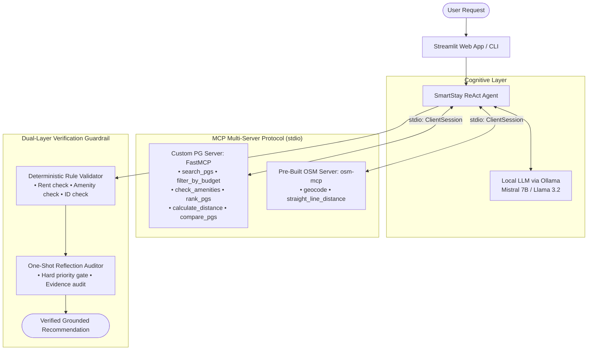
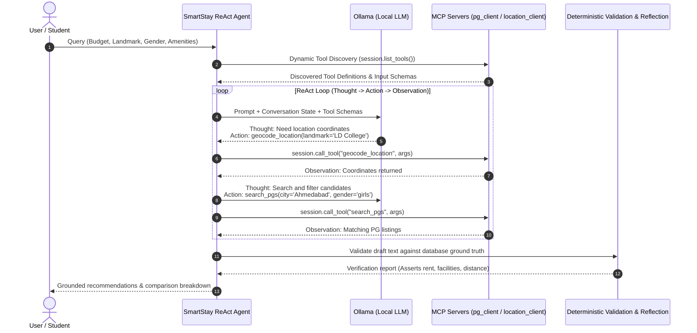

# 🏠 SmartStay: AI-Powered PG Finder Agent Using MCP

<div align="center">

[](https://www.python.org/)
[](https://modelcontextprotocol.io/)
[](https://github.com/jlowin/fastmcp)
[](https://www.npmjs.com/package/osm-mcp)
[-black?style=flat-square&logo=ollama&logoColor=white)](https://ollama.com/)
[](https://streamlit.io/)
[-10B981?style=flat-square&logo=pytest&logoColor=white)](https://docs.pytest.org/)

**Autonomous paying-guest accommodation discovery and ranking agent using Model Context Protocol (MCP), dynamic ReAct reasoning, and deterministic zero-hallucination verification.**

</div>

---

## 🌟 Overview & Key Capabilities

**SmartStay** is an autonomous accommodation discovery agent designed for students and young professionals seeking verified PG (paying-guest) accommodations in Ahmedabad. Built on top of the **Model Context Protocol (MCP)** standard, SmartStay combines dynamic LLM reasoning with deterministic spatial and factual guardrails:

- **Genuine Multi-Server MCP Architecture**: The main agent communicates with a custom FastMCP accommodation server (`smartstay-pg-server`) and a pre-built OpenStreetMap server (`osm-mcp`) via official MCP `ClientSession` over `stdio`.
- **Dynamic Tool Discovery**: Discovers tools and input schemas dynamically at runtime via `session.list_tools()`, eliminating static catalogs.
- **Dynamic ReAct Loop**: Executes autonomous iterative reasoning (`Thought` $\rightarrow$ `Action` $\rightarrow$ `Observation`) over MCP tool transports.
- **Strict Factual Claim Verification**: Sentence-level parsing verifies claimed rent, facilities, and listing IDs against ground truth records in pure Python.
- **Grounded Response Generation**: Final recommendation prose is constructed strictly from verified listings; rejected or over-budget accommodations are purged.
- **Explainable Scoring (0–100 pts)**: Mathematical ranking across budget savings, spatial proximity, amenity matches, and user ratings.
- **Dual Interfaces**: Interactive CLI terminal with automated transcript recording (`agent.py --record`) and a full-featured Streamlit dashboard (`app.py`).

---


## 🏗️ System Architecture



---

## ⚡ ReAct Execution & Tool-Calling Flow



---

## 📊 Explainable Scoring Formula (100 Points)

$$\text{Final Score} = \text{Budget Score (30)} + \text{Proximity Score (30)} + \text{Amenity Score (25)} + \text{Rating Score (15)}$$

| Factor | Weight | Scoring Formula in Code (`scoring_service.py`) | Rationale |
| :--- | :---: | :--- | :--- |
| **Budget Savings** | **30 pts** | $20.0 + \min\left(\frac{\text{Budget} - \text{Rent}}{\text{Budget}} \times 10, 10\right)$ (if rent $\le$ budget; 0 if rent > budget) | Grants 20 pt baseline for meeting budget cap, plus up to 10 bonus points for savings. |
| **Proximity** | **30 pts** | $\le 1\text{ km}: 30\text{ pts}$; $1\text{–}2\text{ km}: 25\text{ pts}$; $2\text{–}3\text{ km}: 20\text{ pts}$; $3\text{–}5\text{ km}: 12\text{ pts}$; $> 5\text{ km}$: decay | Prioritizes walkable accommodations close to college/office. Unknown coordinates are marked unverified and excluded under strict distance limits. |
| **Amenities** | **25 pts** | $25 \times \frac{\text{Matched Requested Amenities}}{\text{Total Requested Amenities}}$ | Proportional reward for each requested facility (Wi-Fi, Food, AC, etc.). |
| **User Rating** | **15 pts** | $15 \times \frac{\text{Rating}}{5.0}$ (unrated defaults to neutral 10 pts) | Grounded in verified resident review scores. |

---

## 📁 Repository Structure

```
SmartStay-AI-PG-Finder/
├── agent.py                    # CLI entrypoint with transcript recording
├── app.py                      # Interactive Streamlit Web Application
├── config.py                   # Central settings (models, paths, weights, timeouts)
├── requirements.txt            # Python dependencies
├── pytest.ini                  # Pytest configuration
│
├── agents/
│   ├── smartstay_agent.py      # Core ReAct agent with dynamic MCP ClientSession discovery
│   └── reflection_agent.py     # One-shot reflection & factual claim auditor
│
├── mcp_servers/
│   ├── __init__.py             # Clean package exports
│   ├── pg_server.py            # Custom accommodation FastMCP server (stdio)
│   ├── pg_client.py            # Official Python MCP client connecting to pg_server.py
│   ├── location_client.py      # Official Python MCP client connecting to osm-mcp
│   └── server_config.json      # Dual-server configuration
│
├── tools/                      # Search, budget, amenity, distance & ranker tools
├── database/                   # Verified PG data (pg_records.json) & locations catalog
├── services/                   # Validation service (factual claim audit) & 0-100 scoring engine
├── models/                     # Pydantic schemas (Listings, Validation, Reflection)
├── prompts/                    # ReAct agent & reflection auditor prompts
├── tests/                      # Automated unit, edge-case, regression & MCP tests (41 tests)
├── docs/                       # Architecture, testing, and viva preparation guides
└── evidence/                   # Recorded CLI demonstration transcripts
```

---

## 🚀 Quickstart Guide

### 1. Prerequisites
- **Python 3.10, 3.11, or 3.12**
- **Node.js 18+ & npx** *(for the external `osm-mcp` geospatial server)*
- **Ollama**: Download from [ollama.com](https://ollama.com) and pull a model:
  ```powershell
  ollama pull mistral:7b
  # or lightweight alternative:
  ollama pull llama3.2:3b
  ```

### 2. Setup & Installation
```powershell
# Clone the repository
git clone https://github.com/PS-kavya-patel/SmartStay-AI-PG-Finder.git
cd SmartStay-AI-PG-Finder

# Create and activate virtual environment
python -m venv .venv
.\.venv\Scripts\Activate.ps1

# Install dependencies
pip install -r requirements.txt
```

### 3. Run Automated Tests
Execute the comprehensive test suite verifying all 5 approval blockers and core features:
```powershell
.\.venv\Scripts\pytest -v -m "not integration"
```
✅ **41 passed, 1 deselected in ~45 seconds** (100% passing across all 5 test modules).

### 4. Run CLI Demonstration
Run the autonomous ReAct agent with automatic live transcript logging:
```powershell
python agent.py --record --query "Find a girls' PG in Ahmedabad under ₹8,000 per month, within 3 km of LD College, with Wi-Fi and food."
```
The full execution trace is automatically captured in [`evidence/demo_transcript.txt`](evidence/demo_transcript.txt).

### 5. Launch Streamlit Web App
```powershell
streamlit run app.py
```
Open **`http://localhost:8501`** in your browser to access the interactive search dashboard, ReAct trace visualizer, and PG comparison table.

---

## 🧪 Comprehensive Test Suite Breakdown

The test suite covers edge cases, boundary conditions, MCP transports, and regression scenarios:

| Test File | Tests Passed | Key Capabilities Verified |
|---|:---:|---|
| [`tests/test_agent.py`](tests/test_agent.py) | **8** | Dynamic MCP tool discovery; ReAct iteration limit (max 6); criteria extraction blockers ("8k", "3 km", "\bac\b", no landmark fallback); final prose regeneration without rejected PGs. |
| [`tests/test_mcp_tools.py`](tests/test_mcp_tools.py) | **14** | FastMCP stdio client discovery; `call_tool()` execution over MCP; strict distance exclusion of missing GPS (`pg_ahm_012`); budget boundary checks; amenity checks; Haversine range validation. |
| [`tests/test_scoring.py`](tests/test_scoring.py) | **3** | Exact mathematical scoring (budget, distance, amenities, rating); unverified distance score calculation; distance cutoff filtering. |
| [`tests/test_search.py`](tests/test_search.py) | **7** | Candidate searches by gender, city, and neighborhood; detail lookups; empty search handling. |
| [`tests/test_validation.py`](tests/test_validation.py) | **9** | Factual claim rejection (₹1 rent, swimming pool); rejected PG prose leakage guard; strict distance rejection of missing GPS; budget and gender violations; reflection correction. |
| **Total** | **41** | **All 41 non-integration tests passing with 0 failures.** |

---

## 🛠️ Troubleshooting & Production Notes

### Ollama Offline or Slow Response
* **Graceful Degradation**: If Ollama is offline or takes longer than `LLM_TIMEOUT` (15s), SmartStay transitions to its verified deterministic execution pipeline (`_deterministic_execution`).
* Tool calls, geocoding, distance calculations, and scoring run deterministically over MCP with zero downtime.

### Windows Subprocess & Stdio Buffering
* FastMCP communicates over standard input/output. Python subprocesses on Windows require unbuffered I/O.
* `mcp_servers/pg_client.py` sets `PYTHONUNBUFFERED=1` and `-u` flag on process invocation to guarantee zero deadlock in stdio communication.

### OpenStreetMap MCP (`osm-mcp`)
* The location client invokes `npx -y osm-mcp` with bounded thread timeouts.
* If external network connectivity is restricted, SmartStay automatically falls back to its verified landmark catalog (`database/verified_landmarks.json`), preventing crashes while preserving spatial accuracy.

---

## 📚 Documentation & Viva Defense Resources

- 📐 **[System Architecture Guide](docs/architecture.md)**: Multi-server MCP design, data flow, and schemas.
- 🧪 **[Testing & Quality Strategy](docs/testing.md)**: Detailed test matrix, edge cases, and regression coverage.
- 🎓 **[Viva Preparation Guide](docs/viva_questions.md)**: Answers to core concepts and all 8 reviewer defence questions.

---

## 📄 License

Distributed under the **MIT License**. Created by **Kavya Patel**.
