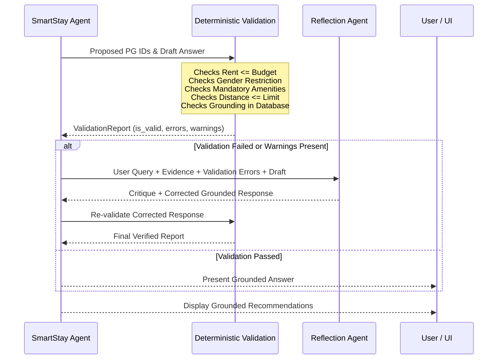

# SmartStay System Architecture

SmartStay is an AI-powered accommodation finder agent built on the **Model Context Protocol (MCP)**, local LLMs (via **Ollama**), and an explainable multi-server agentic loop.

---

## 1. System Architecture Diagram

```mermaid
graph TD
    User([User Request / Query]) --> UI[Streamlit UI / CLI Interface]
    UI --> Agent[SmartStay AI Agent (agents/smartstay_agent.py)]

    subgraph LLM Layer
        Ollama[Ollama Local LLM (Mistral 7B / Llama 3.2 3B)]
    end

    subgraph Model Context Protocol (MCP) Multi-Server Layer
        MCP_PG[Custom SmartStay MCP Server (mcp_servers/pg_server.py)]
        MCP_LOC[Pre-Built Location MCP Server (mcp_servers/location_server.py)]
    end

    subgraph Data & Business Logic
        DB[(PG Dataset: database/pg_data.json)]
        DataService[database/data_service.py]
        Scoring[services/scoring_service.py]
        Tools[tools/*: search, budget, amenities, distance, rank, compare]
    end

    subgraph Dual-Layer Verification
        ValService[Deterministic Validation (services/validation_service.py)]
        RefAgent[One-Shot Reflection Agent (agents/reflection_agent.py)]
    end

    Agent <--> Ollama
    Agent <--> MCP_PG
    Agent <--> MCP_LOC
    MCP_PG --> Tools
    MCP_LOC --> Tools
    Tools --> DataService
    DataService --> DB
    Tools --> Scoring

    Agent --> ValService
    ValService --> RefAgent
    RefAgent --> UI
```

---

## 2. Component Responsibilities

| Component | File Path | Primary Responsibility |
| :--- | :--- | :--- |
| **SmartStay Agent** | `agents/smartstay_agent.py` | Orchestrates dynamic MCP tool discovery, execution loop, state tracking, and stopping criteria. |
| **Custom PG Server** | `mcp_servers/pg_server.py` | Exposes PG business logic (`search_pgs`, `filter_by_budget`, `check_amenities`, `compare_pgs`, `rank_pgs`, `get_pg_details`) via FastMCP standard I/O transport. |
| **Location Server** | `mcp_servers/location_server.py` | Handles geocoding, landmark resolution, and straight-line distance calculations via FastMCP. |
| **Location Client** | `mcp_servers/location_client.py` | Python wrapper client providing fail-safe geocoding with offline landmark catalog fallback. |
| **Scoring Engine** | `services/scoring_service.py` | Computes transparent 0–100 match scores based on budget savings, proximity, amenities, and user ratings. |
| **Validation Service** | `services/validation_service.py` | Deterministic verifier ensuring no budget overruns, gender restrictions match, mandatory facilities exist, and all recommended IDs exist in database. |
| **Reflection Agent** | `agents/reflection_agent.py` | Performs one-shot auditing of proposed response against concrete tool evidence to catch and correct hallucinations. |
| **Web Interface** | `app.py` | Streamlit user interface featuring glassmorphic design, dynamic filters, live MCP observation inspection, and comparison matrices. |

---

## 3. Multi-Server MCP Architecture

SmartStay splits responsibilities cleanly across **two independent MCP servers**:

```
MCP Client (SmartStay Agent)
    ├── [Server 1: smartstay-pg-server (stdio)]
    │      ├── search_pgs
    │      ├── filter_by_budget
    │      ├── check_amenities
    │      ├── compare_pgs
    │      ├── rank_pgs
    │      └── get_pg_details
    │
    └── [Server 2: location-server (stdio)]
           ├── geocode_location
           └── get_distance_and_route_info / calculate_distance
```

### Transport & Protocol
- **Transport**: Standard Input/Output (`stdio`) as demonstrated in Level 2 capstone specifications.
- **Specification**: Model Context Protocol (MCP) using Python SDK (`FastMCP`).
- **Encapsulation**: Servers do not perform arbitrary database mutations; all listings are read from schema-validated JSON records.

---

## 4. ReAct Agentic Execution Loop

1. **User Query Ingestion**: The agent parses user natural language (e.g., *"Find a girls' PG in Ahmedabad under ₹8,000 within 3 km of my college with Wi-Fi and food"*).
2. **Dynamic Tool Discovery**: Queries both connected MCP servers for active tools and schema descriptions.
3. **Reasoning & Tool Selection**:
   - Dispatches `geocode_location` to resolve destination coordinates (e.g. *LD College of Engineering*).
   - Calls `search_pgs` with gender and area parameters.
   - Evaluates budget constraints using `filter_by_budget`.
   - Verifies facilities using `check_amenities`.
   - Computes proximity and scoring via `rank_pgs`.
4. **Stopping Condition**: When sufficient evidence is collected or `MAX_AGENT_ITERATIONS` is reached, the agent halts and drafts its answer.

---

## 5. Dual-Layer Verification Pipeline



---

## 6. Explainable Scoring Engine

The scoring formula allocates up to **100 points**:

$$\text{Total Score} = S_{\text{budget}} + S_{\text{distance}} + S_{\text{amenities}} + S_{\text{rating}}$$

1. **Budget Proximity ($S_{\text{budget}}$, up to 30 pts)**:
   - If rent $\le$ max budget: $20 + \min\left(\frac{\text{Budget} - \text{Rent}}{\text{Budget}} \times 10, 10\right)$.
   - If rent $>$ budget: 0 pts (rejected by validator).
2. **Distance Proximity ($S_{\text{distance}}$, up to 30 pts)**:
   - $\le 1.0\text{ km}$: 30 pts (walking distance)
   - $1.0\text{ to }2.0\text{ km}$: 25 pts
   - $2.0\text{ to }3.0\text{ km}$: 20 pts
   - $3.0\text{ to }5.0\text{ km}$: 12 pts
   - Unverified coordinates: 15 pts (neutral midpoint).
3. **Amenity Match ($S_{\text{amenities}}$, up to 25 pts)**:
   - Ratio of requested amenities satisfied: $\frac{|\text{Matched}|}{|\text{Requested}|} \times 25$.
4. **User Rating ($S_{\text{rating}}$, up to 15 pts)**:
   - $\frac{\text{Rating}}{5.0} \times 15$. Unrated listings default to 10.0 pts.
